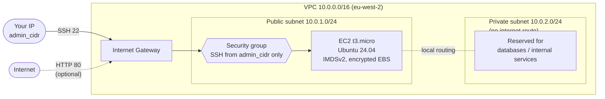

# aws-terraform-vpc-vm

Terraform that builds a small, locked-down AWS lab environment: a VPC with a
public and a private subnet, a security group restricted to your IP, and one
Ubuntu 24.04 VM. Written from scratch as a learning and portfolio project.

## Architecture



## What gets created

| Resource | Purpose |
|----------|---------|
| VPC, internet gateway, route table | Network foundation |
| Public subnet | Hosts the VM |
| Private subnet | Local-only subnet, no route to the internet |
| Security group | SSH only from `admin_cidr`; optional HTTP; restricted egress (80, 443, DNS) |
| Default security group | Emptied so it cannot be used by accident |
| EC2 instance | Ubuntu 24.04 LTS, IMDSv2 required, encrypted gp3 root volume |
| Key pair | Built from your public key |
| VPC flow logs (optional) | Set `enable_flow_logs = true` to send traffic logs to CloudWatch |

## Security choices

- SSH is never open to the world. `admin_cidr` is required and validation rejects `0.0.0.0/0`.
- The instance requires IMDSv2 and has an encrypted root volume.
- Egress is limited to HTTP, HTTPS and DNS rather than "allow all".
- The default security group is locked down.
- No secrets in the repo: `terraform.tfvars` and state files are git-ignored.

## Usage

Prerequisites: Terraform 1.6+, an AWS account, and AWS credentials configured
(for example `aws configure` with a least-privilege IAM user). The `availability_zone` variable must belong to your chosen `region`.

```bash
cp terraform.tfvars.example terraform.tfvars   # then edit it
terraform init
terraform plan
terraform apply
```

Connect with the `ssh_command` output. Find your public IP with
`curl -s https://checkip.amazonaws.com` and use it as `<ip>/32` in `admin_cidr`.

**Tear down when finished** so nothing keeps costing money:

```bash
terraform destroy
```

## Cost notes

- Check your account's free-tier terms. Newer AWS accounts use a credit-based
  free plan rather than 12 months of free instance hours.
- A NAT gateway is deliberately not included because it is not free.
- A public IPv4 address is charged by AWS even on small instances.
- Set up an AWS Budget alert before you apply anything.

## Testing and CI

GitHub Actions runs on every push:

- `terraform fmt -check`, `terraform init -backend=false` and `terraform validate`
- `tflint` with the AWS ruleset
- `checkov` static security analysis

Run the same checks locally: `terraform fmt -recursive && terraform validate`.

Checkov passes with four documented exceptions, each explained in a comment
next to the resource (public IP on the lab VM, paid detailed monitoring, no
instance profile, and default CloudWatch encryption for the optional flow logs).

## Roadmap

- Remote state in S3 with DynamoDB locking
- Split into reusable modules (network, compute)
- SSM Session Manager instead of SSH
- An Azure equivalent using the same layout

## Licence

MIT
